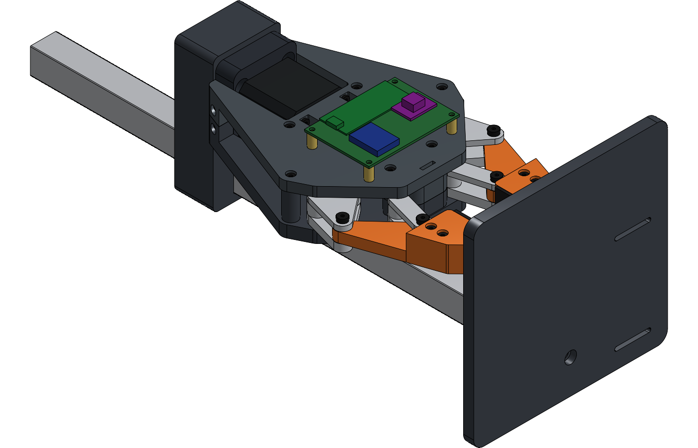
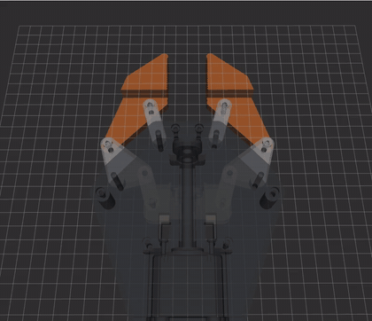
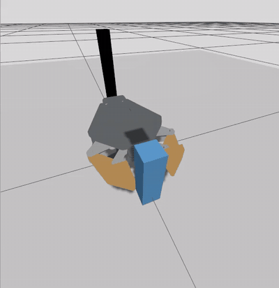

# Lead-Screw Parallel Gripper

A 3D-printable parallel gripper for robot arms with an ISO 9409 flange, designed to hold a 500 g part, with a ROS 2 Jazzy stack from robot description to hardware interface.



| RViz: one jaw-gap command drives all nine linkage joints | Gazebo: close, lift 50 mm, hold, release |
|---|---|
|  |  |

## Status

| Part | State |
|---|---|
| Mechanical design (rev 7) | Complete in CAD, with kinematic, force, structural, fastener and collision checks |
| Prototype | First print assembled; some moving parts rubbed, so it was taken apart and is being reprinted with revised clearances |
| Grip force | **Predicted** at ≥ 26 N per jaw at 0.7 A (21 N needed for 500 g). Not yet measured |
| ROS 2 | Robot description from Onshape, linkage kinematics, Gazebo grasp test, ros2_control hardware interface and Pico firmware. Tested against a simulated Pico; **not yet run on the real gripper** |

## How it works

- **Drive:** a NEMA 17 stepper turns a Tr8×8 lead screw (8 mm per turn), which moves a carriage 26.5 mm over the full stroke.
- **Linkage:** on each side a connecting rod turns a 90° bell crank, and a parallelogram keeps the jaw face parallel. Both sides mirror each other, so the gripper has one degree of freedom. Jaw gap 0–60 mm (20–80 mm with the wide tips).
- **Force:** mechanical advantage rises from 0.35 closed to 0.75 at 60 mm, so the firmware lowers the motor current as the jaws open to keep about 30 N per jaw. A hardware current ceiling (0.7 A) keeps the screw force below what the printed parts are checked for.
- **Back-driving:** the Tr8×8 is not self-locking, so the driver keeps holding current on while gripping.
- **Sensing:** an AS5600 magnetic encoder on the screw end tracks position and detects when the jaws stop (homing, and closing on an object).
- **Electronics:** Raspberry Pi Pico, TMC2209 driver, powered from a USB-C power bank through a 9 V trigger board.

Full numbers and assumptions: [`gripper_fabrication_rev7/DESIGN_REPORT.md`](gripper_fabrication_rev7/DESIGN_REPORT.md).

## Layout

| Path | What it is |
|---|---|
| `gripper_fabrication_rev7/` | The design: parametric model and checks (`source/`), `DESIGN_REPORT.md`, `BOM.csv`, print list, Onshape FeatureScript, images |
| `gripper_fabrication_rev7/firmware/` | Raspberry Pi Pico firmware: `bench.py` (bring-up tests and stand-alone demo) and the ROS 2 firmware (`ros_main.py`, `gripper_core.py`, `hal_pico.py`), with laptop tests |
| `docs/BUILD_AND_TEST_GUIDE.md` | Assembly and bench-test steps |
| `ros2_ws/` | ROS 2 Jazzy workspace. See [`ros2_ws/README.md`](ros2_ws/README.md) |

STL, STEP and build-guide images aren't stored. Regenerate them with `export.py` (run it before `fit_coupons.py`) and `guide_render.py` in `gripper_fabrication_rev7/source/`. Earlier revisions are in the git history.

## Notes

- **Origin of the mechanism:** the linkage layout and its proportions come from an existing lead-screw gripper design that I studied. Everything around the linkage was redesigned for 3D printing: double-shear pivots, the drive and thrust bearing, housing, swappable tips, electronics, ISO 9409 mount and bench stand.
- **Honest numbers:** every figure in this repository is labelled as predicted, simulated or measured. Nothing is measured on hardware yet.

## Setup (Ubuntu)

Keep CAD tools out of the system Python:

```bash
python3 -m venv ~/.venvs/gripper
source ~/.venvs/gripper/bin/activate
pip install cadquery numpy scipy matplotlib pyvista
```

Run the scripts from inside `gripper_fabrication_rev7/source/`, for example `python3 check.py 41`. Run `deactivate` when you're done.
