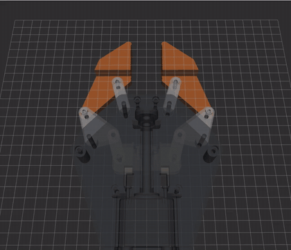
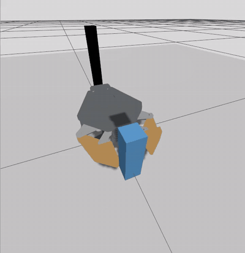

# Lead-screw gripper in ROS 2 Jazzy

The rev 7 lead-screw parallel gripper as a ROS 2 robot:

- a robot description exported from the Onshape assembly, and a kinematics node that turns one jaw-gap value into all nine joint positions (RViz);
- a Gazebo Harmonic simulation with ros2_control that closes on a block, lifts it and sets it down;
- a **ros2_control hardware interface** for the real gripper, driven by the standard parallel-gripper action controller and talking to Pico firmware over USB serial. It is tested end to end against a **fake Pico** (the real firmware logic with a simulated motor, encoder and object), see [Hardware interface](#hardware-interface-real-gripper-or-fake-pico).

Nothing here has run on the real gripper yet. A first prototype was printed and assembled; some parts rubbed and it is being reprinted.

| RViz: the node drives the full linkage (GIF recorded on rev 6, 0–66 mm) | Gazebo: close, lift 50 mm, hold, release |
| --- | --- |
|  |  |

## Packages

| Package | What it holds |
| --- | --- |
| `lead_screw_gripper_description` | The robot: Onshape export (`onshape/`), xacro wrappers (`urdf/`), Gazebo controller settings (`config/`), the grasp-test world (`worlds/`), RViz settings, and the phase 3 hand-written model |
| `lead_screw_gripper_kinematics` | Python: the linkage math (`linkage.py`, no ROS), the kinematics node (`jaw_node.py`), the scripted grasp test (`grasp_demo.py`), launch files and tests |
| `lead_screw_gripper_hardware` | C++ ros2_control `SystemInterface` plugin: one `jaw_gap` joint, talks to the Pico over serial |
| `lead_screw_gripper_bringup` | Robot description with ros2_control, controller settings, `hardware.launch.py`, the `gap_to_joints` node, the `fake_pico`, and launch tests |

## Build

On Ubuntu 24.04 with ROS 2 Jazzy installed (desktop, `ros-dev-tools`, and `rosdep init` done):

```bash
cd ~/projects/Gripper-Claude_Onshape/ros2_ws
rosdep install --from-paths src --ignore-src -y
colcon build
source install/setup.bash
```

`rosdep` reads the `package.xml` files and installs anything missing: xacro, ros_gz, ros2_control, the controllers and so on. It asks for your password through `sudo`, so run it in a regular terminal (Ctrl+Alt+T), not the Claude app's terminal panel. Source `install/setup.bash` again in every new terminal.

## Run

**RViz with a jaw-gap slider:**

```bash
ros2 launch lead_screw_gripper_kinematics view_gripper.launch.py
```

A small "Jaw gap" window has a slider over the full jaw range (0 to 60.5 mm since rev 7); moving it moves the whole linkage. Add `slider:=false` to leave the slider out, then command the gap from a terminal (in metres):

```bash
ros2 topic pub --once /jaw_gap_command std_msgs/msg/Float64 "{data: 0.045}"
```

**Gazebo grasp test** (the prefix runs Gazebo on the NVIDIA GPU):

```bash
__NV_PRIME_RENDER_OFFLOAD=1 __GLX_VENDOR_LIBRARY_NAME=nvidia ros2 launch lead_screw_gripper_kinematics sim_grasp.launch.py
```

After about 8 s the camera moves in. The test starts at 10 s and takes about 15 s. Options: `demo:=false` (just the gripper and the block, command it yourself), `rviz:=true`. Stop with Ctrl+C in the same terminal, and give it a few seconds to close.

To watch the block's height while it runs:

```bash
gz topic -e -t /world/grasp_test/dynamic_pose/info | grep -A8 test_box
```

**Tests** (no ROS needed, about 0.1 s):

```bash
cd src/lead_screw_gripper_kinematics
python3 -m pytest -q test
```

## How it works

### CAD to robot model

The Onshape document has a `Robot export` assembly, a copy of Assembly 1 marked up for [onshape-to-robot](https://github.com/Rhoban/onshape-to-robot):

- Each Group (frame, bell crank, front crank, carriage) becomes one link, because those parts move as one rigid body.
- Mates named `dof_…` become joints: the bell crank, front crank, finger and conrod revolutes on each side, plus the carriage slider.
- URDF can only describe a tree, but each side has two closed loops. They are cut at F2 (front crank to finger) and at C (conrod to carriage) by mates named `closing_…`. The export turns each cut into a pair of marker frames, which must sit on top of each other in any valid pose.

The export reads frozen version `robot-export-v1`. Settings are in `onshape/config.json`; re-run it with `onshape/export.sh`. The first export of a version uses about 150 Onshape API requests. Later runs read `~/.cache/onshape-to-robot` and use none. The export's zero pose (every joint at 0) is a **41.19 mm jaw gap**, because that is where the assembly sat when the version was saved.

### Kinematics node

The gripper has one degree of freedom. `linkage.py` turns a jaw gap into all nine joint values in closed form:

1. **Inverse kinematics:** gap = 2·L·(sin θ − sin θ_closed) with L = 28 mm, solved for the bell-crank angle θ.
2. **Loop closure:** the parallelogram O1–F1–F2–O2 turns the front crank by θ too, and turns the finger back by −θ, so the jaw translates without rotating. The offset slider-crank gives the carriage pin: C_x = D_x − √(22.68² − (24.91 − D_y)²).
3. **Joint conventions:** every revolute axis in the export points down (−z), so counterclockwise angles change sign. The lower side mirrors the upper side.

`test/test_linkage.py` checks this against the CAD: the four poses in `ROS2_HANDOFF.md` section 9 (θ, C_x and F1 within 0.01 mm and 0.01°). It also runs forward kinematics on the exported URDF at six jaw gaps, checking that all four loops close within 0.01 mm and that the fingers never rotate.

### Simulation

`urdf/lead_screw_gripper_gazebo.urdf.xacro` wraps the export with:

- a fixed rail and a `lift` slide, so a grasp can be tested against gravity;
- 2 mm box pads on the jaw faces (35 × 19.5 mm, measured from the finger mesh). The pads are the only collision shapes, which keeps contact fast and stable;
- ros2_control with `gz_ros2_control`, a position command on every joint.

Gazebo's physics engine does not close the linkage loops, so the node does. In sim mode only the upper bell crank is driven toward the target, and its torque cap sets the grip force. Every other joint is commanded from the **measured** upper crank angle, the way the parallelogram and the shared carriage tie them together in the real gripper. Driving all nine joints separately made a blocked finger twist, and let the block drift sideways and rotate out of the grip.

## Results

From the Gazebo test, run twice with the same numbers both times:

| Check | Result |
| --- | --- |
| Jaws close on the 30 mm block | Stop at 15.0 mm / 15.0 mm from the centreline |
| Fingers stay parallel under load | 0.00° tilt (about 1° for an instant at first contact) |
| Lift 50 mm | Block rises 50.0 mm (50.0 → 100.0 mm), no slip |
| Hold 3 s | Height steady, block tilt ≤ 0.1° |
| Set down and release | Block back at 50.0 mm, still standing |

### Limits, honestly

- **Simulated, not measured.** Nothing has run on the real gripper yet.
- **The grip force is an input, not a result.** The upper bell crank's torque cap (3 N·m) was chosen to give about 35 N per jaw, near the design's predicted ≥33 N. The simulation shows that a grip of that size holds a 50 g block. It does not check the 33 N prediction itself.
- **The loops are closed in software.** In Gazebo the follower joints are position-controlled from the measured crank angle; the physics engine does not enforce them.
- **Masses** come from Onshape mass properties with printed parts treated as solid: 1.09 kg in total. Real prints at 30–40% infill will be lighter.
- **The motor and lead screw are not modelled as actuators.** The jaw speed is limited to the predicted full stroke in 1.6 s.

## Troubleshooting

- **`sudo` fails in the Claude app's terminal** with "no new privileges": use a regular terminal (Ctrl+Alt+T).
- **ROS errors about Python 3.13 or missing modules:** conda's `base` environment is active. Run `conda deactivate`. Auto-activation is off on this laptop.
- **Gazebo is slow:** use the NVIDIA prefix shown above. `nvidia-smi` should list `gz sim gui` while it runs.
- **Windows stay open after Ctrl+C:** wait a few seconds, then close RViz with ✕ and choose "Close without Saving".
- **`robot_state_publisher` warns about root link inertia** (RViz view only): harmless. KDL ignores the base link's mass, and RViz still draws everything correctly.

## Hardware interface (real gripper or fake Pico)

```
 action /gripper_controller/gripper_cmd  (control_msgs/action/ParallelGripperCommand)
        │
 parallel_gripper_action_controller      standard ROS 2 controller, config only
        │  jaw_gap position (m) + effort (N per jaw, grip force limit)
 lead_screw_gripper_hardware             ros2_control plugin (C++)
        │  one-line commands over USB serial (/dev/ttyACM0), or a pseudo-terminal for the fake Pico
 Pico: ros_main.py → gripper_core.py → hal_pico.py      (fake Pico: gripper_core.py → hal_sim.py)
        │
 TMC2209 → stepper → Tr8×8 screw;  AS5600 encoder on the screw end

 joint_state_broadcaster → /joint_states (jaw_gap) → gap_to_joints → the nine linkage joints → RViz
```

**One joint.** ros2_control sees a single virtual prismatic joint, `jaw_gap`: the narrow-tip pad gap in metres, 0 to 0.0605. The nine real linkage joints are nonlinear functions of it, which URDF mimic joints cannot express, so `gap_to_joints` computes them with the same `linkage.py` as the RViz and Gazebo work. With the wide tips fitted, the real pad gap is 20 mm more than `jaw_gap`.

**Grip force.** The action's `effort` is the grip force limit in N per jaw (default 30 N; about 21 N holds 500 g). The firmware turns it into motor current: the 30 N current-vs-gap table from the design report, scaled by force / 30, kept between 0.15 A and the 0.70 A hardware ceiling. **This mapping is predicted from the design model, never measured.**

### Run it

```bash
cd ~/projects/Gripper-Claude_Onshape_V2/ros2_ws
conda deactivate                     # conda's Python breaks ROS
colcon build --symlink-install
source install/setup.bash
```

No hardware, fake Pico (a 30 mm object is placed between the jaws after homing):

```bash
ros2 launch lead_screw_gripper_bringup hardware.launch.py fake:=true object_mm:=30
```

Real gripper (after the bench tests, with `ros_main.py` saved on the Pico as `main.py`, and Thonny closed):

```bash
ros2 launch lead_screw_gripper_bringup hardware.launch.py port:=/dev/ttyACM0
```

On start-up the hardware interface **homes the gripper by closing the jaws until they stop**. Keep objects out of the jaws while it starts.

Open to 45 mm, then close on whatever is between the jaws with at most 25 N:

```bash
ros2 action send_goal /gripper_controller/gripper_cmd control_msgs/action/ParallelGripperCommand "{command: {name: [jaw_gap], position: [0.045], effort: [30.0]}}"
```

```bash
ros2 action send_goal /gripper_controller/gripper_cmd control_msgs/action/ParallelGripperCommand "{command: {name: [jaw_gap], position: [0.0], effort: [25.0]}}"
```

The result says `reached_goal: true`, or `stalled: true` when an object stopped the jaws (it then keeps holding). `use_mock_hardware:=true` runs ros2_control's built-in mock hardware instead, with no serial port at all.

### Serial protocol (ASCII lines, the host always speaks first)

| Host sends | Pico replies | Meaning |
|---|---|---|
| `?` | `ID lsg 1` | Identify, protocol version 1 |
| `R` | `S <gap_mm> <speed_mm_s> <amps> <flags>` | State. `gap_mm` is `nan` until homed |
| `H` | `OK` | Home: close at 0.3 A and 10 mm/s until the encoder shows the jaws stopped |
| `G <gap_mm> <force_N>` | `OK` or `ERR <reason>` | Move to a gap (0–60 mm). Closing runs at 10 mm/s and stops and holds if an object stalls the jaws |
| `X` | `OK` | Stop, keep holding current |
| `O` | `OK` | Driver off: the jaws go limp (the screw back-drives) |

`flags` (added together): 1 homed, 2 moving, 4 stalled on an object, 8 no motor power, 16 driver not answering, 32 encoder not answering, 64 homing. Errors: `ERR not_homed`, `not_checked` (bench tests not passed), `fault`, `busy` (homing), `bad_value`, `bad_command`, `line_too_long`. A fault switches the driver off and clears the homed flag; the hardware interface then reports an error.

### Tests

```bash
colcon test --packages-select lead_screw_gripper_kinematics lead_screw_gripper_bringup
colcon test-result --verbose
```

```bash
cd ../gripper_fabrication_rev7/firmware && python3 -m pytest -q tests
```

- **Firmware logic** (42 tests, `gripper_fabrication_rev7/firmware/tests`): protocol, homing (narrow and wide tips, reversed encoder), moves and retargeting, speed limits, clamping, stall and hold on an object, the force-to-current rule and the 0.70 A ceiling, power loss, silent driver, driver reset, encoder loss, homing that never finds a stop.
- **End to end with the fake Pico** (launch test): action goal to 45 mm reaches it; closing on a 30 mm object returns `stalled` at 30.0 mm; `/joint_states` carries `jaw_gap` and the nine linkage joints; killing the fake Pico mid-run makes the hardware inactive without crashing the controller manager.
- **Wrong port** (launch test): the plugin prints a clear error ("cannot open … Is the gripper plugged in, and is Thonny closed?") and ros2_control_node stops, which is how the controller manager handles hardware that cannot start.
- The three Pico files compile with `mpy-cross` (MicroPython 1.29) for the RP2040.

### Verified and not verified

| Verified without hardware | Not verified until the gripper is connected |
|---|---|
| Protocol, state machine, limits and fault handling (unit tests on the real firmware logic) | That the firmware runs on a real Pico (memory, timing, garbage-collection pauses) |
| Hardware interface ↔ firmware logic over a real serial device (pseudo-terminal) | USB serial on `/dev/ttyACM0`: latency, reconnecting |
| Controller → interface → state → nine joints | TMC2209 UART and PIO step pulses while serial is busy |
| Stall and hold logic against a simulated object | Real stall threshold, encoder direction, missed steps |
| Force → current rule applied and capped at 0.70 A | The actual grip force for a given current |

### Bring-up checklist (when the gripper is rebuilt)

1. Run the bench tests in order (`docs/BUILD_AND_TEST_GUIDE.md`, `bench.t1_power()` to `bench.t6_home()`), so `bench_cfg.json` on the Pico holds the motor and encoder directions and `checked: true`.
2. Copy `gripper_core.py` and `hal_pico.py` to the Pico, and `ros_main.py` as `main.py`. Close Thonny.
3. With the jaws empty: `ros2 launch lead_screw_gripper_bringup hardware.launch.py rviz:=true`. Watch it home.
4. Send small moves first (30 → 35 mm), then a close on a soft object at 10 N, then 30 N.
5. Measure the grip force with a scale between the jaws at a few gaps, and compare with the prediction.
6. To get back to the Thonny shell, press the Pico's BOOTSEL button while `ros_main.py` runs.

### Design notes

- Serial talk happens inside the control loop's `read()` and `write()`; at 50 Hz with short replies that is fine for a gripper, not for a fast arm.
- `write()` only sends `G` when the commanded gap changes by more than 0.05 mm or the force by more than 0.5 N.
- Activation blocks while homing (up to 20 s), which is acceptable at start-up only.
- The fake Pico runs the same `gripper_core.py` the Pico runs; `setup.py` installs it straight from the firmware folder, so there is one copy.
